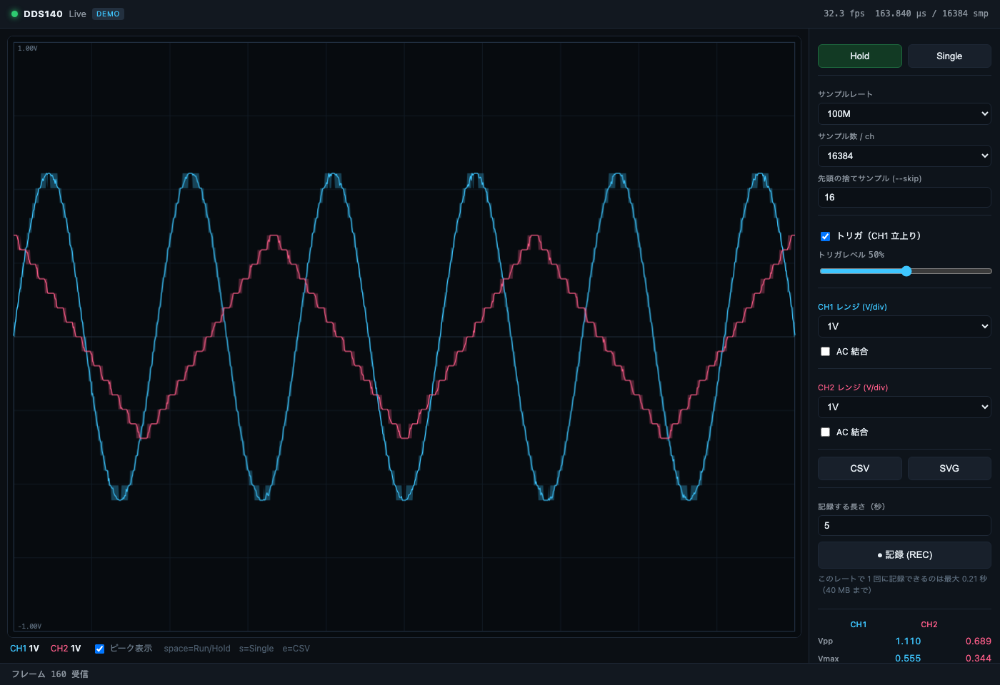

# SainSmartDDS140

macOS client for the **SainSmart DDS140** USB oscilloscope (`8312:8312`) —
protocol reverse-engineered from the vendor's .NET app, with a CLI and a
browser UI. Works on Windows too (same pyusb code).

SainSmart **DDS140**（USB オシロスコープ、オプションで信号発生器・ロジックアナライザ）を
**macOS から**扱うための実装。公式ソフトは Windows XP〜8 専用なので、
USB プロトコルを自作のクライアントで再現した。

**現状: macOS / Windows の実機で動作確認済み（CLI と UI の両方）。**

## UI（ブラウザで開く・依存なし）

```sh
python3 -m dds140 ui          # http://127.0.0.1:8765/ が開く
python3 -m dds140 ui --demo   # 実機なしで UI を確認（合成波形）
```



- 波形は min/mean/max の包絡で描画（ピーク表示の ON/OFF 可）。
- レート・サンプル数・レンジ・AC 結合・先頭 skip・トリガを UI から変更。
- Run/Hold、Single、CSV / SVG の書き出し。
- キー: `space` Run/Hold、`s` Single、`e` CSV。
- 実機が抜けたら自動で待機し、挿し直すと復帰する。
- サーバは 127.0.0.1 のみで待ち受け。外部に公開しない。

## 入力の確認

```sh
python3 -m dds140 input-check                 # チャネルごとに信号が来ているか判定
python3 -m dds140 monitor                     # 数値をライブ表示（プローブ確認）
python3 -m dds140 spectrum --rate 240k        # 何 Hz の成分が乗っているか
python3 -m dds140 spectrum --f-lo 800 --f-hi 1200   # 1kHz の矩形波を狙い撃ち
```

本物の信号は**レンジを変えても AC RMS が変わらない**。ADC のノイズやドリフトは
レンジ（ゲイン）に比例して変わる。この違いで「挿さっているか」を判定する。

## サンプルレートの校正（重要）

`cmd 148` のレートは**ラベルであって実測値ではない**。内蔵の 1 kHz 標準矩形波
（BNC 間の小さな金属ピン）を入力に当てて校正する:

```sh
python3 -m dds140 calib-rate     # プローブを内蔵矩形波に当てて実行
python3 -m dds140 calib-rate --show
```

実測では実効レートはラベルの 1/22〜1/28 で、**100M 設定（実効 3.58 MS/s）だけが
USB 帯域と一致して時間軸が正しい**。校正値は `~/.dds140/rates.json` に保存され、
CLI/UI は自動で使う。詳細は `docs/protocol.md`。

## 信号の記録

```sh
python3 -m dds140 record --capacity                     # レートごとの上限
python3 -m dds140 record --rate 240k --seconds 10 -o captures/rec.bin
python3 -m dds140 record --rate 100M --samples 65536 --frames 20 -o captures/multi.bin
```

UI の「● 記録 (REC)」からも保存できる（`captures/` に `.bin` + `.json`、`.csv` も DL 可）。

**連続記録できるのは 240 kS/s（1 フレーム = 最大 87 秒）だけ**。
39k/625k/100M は転送が実時間より速く、届いたサンプルが時間的に連続している
保証がない（`realtime_factor` として記録・警告する）。
詳細と実測値は `docs/recording.md`。

## CLI

```sh
cd ~/works/tools/SainSmartDDS140

# デバイスが見えるか（descriptor と簡易自己診断）
python3 -m dds140 info

# 個体キャリブレーション値
python3 -m dds140 cal

# 1 フレーム取って統計 + CSV
python3 -m dds140 capture --samples 65536 -o wave.csv

# 波形を SVG に（依存なし）
python3 -m dds140 capture --samples 65536 --skip 16 --svg wave.svg

# matplotlib がある場合は画面表示も
python3 -m dds140 capture --samples 65536 --plot

# レンジとレートを指定（先頭 16 サンプルは整定で跳ねるので捨てる）
python3 -m dds140 capture --rate 10M --ch1 200mV --ch2 1V --ac1 --samples 8192 --skip 16 -o w.csv
```

依存: `pyusb` + `libusb-1.0`（macOS は brew の `libusb` が入っていれば OK）。
libusb の場所を明示したいときは `DDS140_LIBUSB=/path/to/libusb-1.0.dylib`。

## オシロとして何ができるか

| 機能 | 状態 |
|---|---|
| 2ch 同時取り込み（8 bit、CH1/CH2 交互） | ✅ macOS / Windows で動作確認 |
| サンプルレート 100M / 10M / 625k / 240k / 39k | ✅ 動作確認（240k は待ちが長い） |
| 200 MS/s 合成モード | ⬜ 未対応（データ配置が未検証） |
| 垂直レンジ 2V/1V/500mV/200mV/100mV/50mV per div | ⚠️ コマンドは送信・応答確認。実減衰量は未校正 |
| AC/DC 結合（CH 単位） | ⚠️ コマンドは送信。波形での確認は未 |
| 個体キャリブレーション（ゼロ点・ゲイン） | ✅ 起動時に読み出して電圧換算に使用 |
| トリガ（ハード） | ⬜ 未対応（UI はソフトウェアトリガ） |
| 連続記録（240 kS/s・最大 87 秒） | ✅ 動作確認 |
| CSV / 生バイト / SVG 出力 | ✅ |
| ロジックアナライザ（8ch） | ⬜ 未着手 |
| 信号発生器 | ⬜ コマンドは判明、未実装 |

出力: CSV（`time_s,ch1_v,ch2_v`）、生バイト（`--raw`）、SVG（`--svg`、依存なし）、
matplotlib ウィンドウ（`--plot`）。

**注意**: 各フレームの先頭 2〜10 サンプルは ADC/マルチプレクサの整定で跳ねる
（無入力でも 0.5〜7V 相当まで振れる）。`--skip 16` を付けると消える。

## 中身

| パス | 内容 |
|---|---|
| `dds140/transport.py` | 制御転送（`0x80` vendor IN 1B）と EP `0x82` の読み出し |
| `dds140/const.py` | 実機で確認したコマンド・レート・レンジの表 |
| `dds140/scope.py` | キャリブレーション、設定、1 フレーム取得、電圧換算 |
| `dds140/cli.py` | `info` / `cal` / `capture` / `record` / `ui` |
| `dds140/record.py` | 記録（1 フレーム長時間・複数フレーム）、CSV 変換 |
| `dds140/webui.py` | ローカル UI のサーバ（標準ライブラリのみ）とワーカー |
| `dds140/web/` | UI の HTML / CSS / JS（canvas 描画） |
| `dds140/selftest.py` | 実機でレート・レンジを一通り試す（開発用） |
| `docs/sources.md` | **マニュアル・配布ソフトの保全記録**（出典・ハッシュ） |
| `docs/manual-notes.md` | マニュアルの要点（仕様・レンジ別ノイズ・記録機能。原本は再配布しない） |
| `docs/protocol.md` | **プロトコルの全容（実測ベース）** |
| `docs/recording.md` | 記録の実測上限と落とし穴 |
| `docs/hardware.md` | 部品・USB 構成 |
| `docs/reverse-engineering.md` | どうやってプロトコルを割ったか（手順の記録） |
| `tools/usb_probe.py` | 汎用 USB 調査（列挙・descriptor・単発転送） |
| `tools/winprobe/` | Windows 実機で DLL を直接叩く検証ハーネス（C） |
| `tools/winproxy/` | ベンダ DLL の差し替えプロキシ（通信ログ用, 32bit DLL） |
| `tools/ghidra/` | 逆コンパイル用 Ghidra スクリプト |

## テスト

```sh
python3 -m unittest discover -s tests     # ハードウェア不要
python3 -m dds140.selftest                # 実機が必要（レート・レンジ総当たり）
```

## 制約（守ること）

- **読み取り専用から。** EEPROM（24LC64I）への書き込み、ファームの差し替えはしない。
  J1 を外すと `04b4:8613`（ブートローダ）になり、ベンダ FW を戻さないと動かない。
- **オシロ入力の定格**: 1x で ±5V、10x プローブで ±50V。繋ぐ前にレンジとプローブを確認。
- USB はバスパワー 500mA。ハブ経由で不安定なら直挿し。
- 波形には測定対象の信号が入る。`captures/` と `vendor/` は Git 管理外。

## ライセンス

MIT（`LICENSE`）。ただし `docs/` に書いた仕様・プロトコルの記述はこのプロジェクトの
成果物で、ベンダのマニュアル本文や配布バイナリは含まない（再配布していない）。

## 参考

- 秋月電子の商品ページ（販売終了）: <https://akizukidenshi.com/catalog/g/g110159/>
- マニュアルと配布ソフトの出典: `docs/sources.md`（ベンダ物は再配布せず、手元の `vendor/` のみ）
- sigrok: <https://sigrok.org/wiki/SainSmart_DDS140>
- lsusb -v 生ログ: <https://sigrok.org/wiki/SainSmart_DDS140/Info>
- 既存の RE: <https://github.com/SamantazFox/dds140-reverse-engineering>
- ベンダ製品ページ（discontinued）:
  <https://www.sainsmart.com/products/sainsmart-dds-140-40m-200m-s-virtual-oscilloscope-signal-generator>
